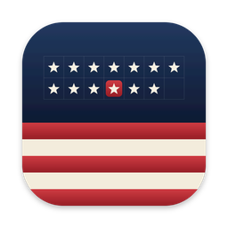

# Minuteman

A free, personal calendar app in the style of Fantastical, on top of Google
Calendar (and, optionally, Todoist), for the Mac and Windows. An iPhone
version is in progress ([docs/ios-setup.md](docs/ios-setup.md)). Built with
[Tauri v2](https://tauri.app/): a Rust core plus a TypeScript web UI.

Website: [lukejs97.github.io/minuteman](https://lukejs97.github.io/minuteman/)
([privacy policy](https://lukejs97.github.io/minuteman/privacy.html)).

## Features

- **Views:** Day, a few days (3 unless you change it in Settings), Week,
  Month, Year and Agenda, for all your Google accounts' calendars together.
  The multi-day and week views slide through the days (two fingers on a
  trackpad, or a finger on a phone), as in Apple's Calendar.
- **Add in a sentence:** click **+** (or press `N`), or double-click a day, a
  day's heading or a time (right-click for New Event or New Task), and type
  something like
  "Lunch with Sam tomorrow 1pm at Cafe Roma", "Standup every weekday at 9:30
  with ana@example.com" or "Conference Nov 12-14 in Berlin, remind me 1 day
  before". The fields below fill in as you type; change any of them by hand
  (title, times, all day, place, repeat, alert, guests, notes, calendar).
  Switch to **Task** to add a Todoist task ("Submit expenses Friday p1", "Pay
  rent every month on the 1st").
- **Edit and delete:** click an event or task, then **Edit** or **Delete**. For
  a repeating event, choose this event only or all of them. Guests are emailed
  about changes if you tick the box.
- **Details:** time, place (with a map link), a **Join** button for Google
  Meet, Zoom, Teams or Webex calls, guests and their replies, and notes.
- **Drag to move:** in Day and Week view, drag an event to another time or
  day, or its bottom edge to change its length (15-minute steps). In Month view
  and the all-day row, drag anything to another day. Tasks move too (not
  repeating ones).
- **Search** (magnifier, `/` or Cmd/Ctrl+F): events and tasks from a year back
  to a year ahead.
- **Menu bar** (notification area on Windows): the Minuteman icon opens a
  small month calendar with the next few days, and **+** to add. `⌥⌘N`
  (Ctrl+Alt+N on Windows) adds an event from any app. Closing the window keeps
  Minuteman running there; quit from the icon's right-click menu or with ⌘Q.
  What's next shows beside the icon ("Standup in 12 min", "○ Pay rent at
  3:00 PM" for a task), or what's on now if nothing starts before it ends
  ("Work until 5:00 PM"); turn it off in Settings. Resize the small window from its edges; drag it (or click its
  detach button) to keep it open as a window of its own.
- **Stays in sync:** changes made elsewhere (Google Calendar, Todoist, your
  phone) show up within a minute while Minuteman is open, and as soon as you
  come back to it.
- **Alerts** at each event's reminder times from Google Calendar, also with
  the window closed.
- **Time to leave** (Mac; Settings → Time to leave): for events at a real
  place in the next 3 hours, an alert when it's time to set off, from your
  Mac's location and Apple Maps' driving time (plus 5 minutes).
- **Apple Calendar and Reminders** (Mac; Settings): events from the Calendar
  app (iCloud, Exchange, anything added on the Mac) and reminders with a due
  date, alongside the rest. Tick reminders off here; other changes happen in
  Apple's apps for now. Calendars from your Google accounts start switched off
  (Settings → Choose calendars…), so they aren't shown twice.
- **Offline:** opens straight away with what it last loaded, and shows (and
  searches) it without internet.
- **Settings** (the gear, or `,`): Google accounts, Todoist, how many days
  the multi-day view shows (2 to 7; each device remembers its own), and on the
  desktop the menu bar, time to leave, and Apple Calendar and Reminders.
- **Several Google accounts:** Settings → Google accounts → **Add account**. While the
  Google project is in **Testing**, add the extra account as a test user first
  ([docs/google-cloud-setup.md](docs/google-cloud-setup.md#6-publish-the-app-in-production)).
- **Todoist** (optional): Settings → Todoist, then paste your API token
  from Todoist → Settings → Integrations → Developer. Tasks with a due date
  appear with a checkbox in every view, overdue ones on today.

**Keyboard:** `D` `X` `W` `M` `Y` `A` switch views (`X` is the multi-day one), `T` jumps to today, `N` adds
an event or task, `/` searches, `,` opens Settings, `←` `→` go back and forward (or swipe sideways
with two fingers). Click a date in the week header, month grid or year view to
open that day.

## Installing on a Mac

GitHub builds the Mac app (`.github/workflows/build-macos.yml`); no developer
tools needed.

1. Once: do the Google setup in
   [docs/google-cloud-setup.md](docs/google-cloud-setup.md). Then on GitHub,
   Settings → Secrets and variables → Actions → **New repository secret**: add
   `GOOGLE_CLIENT_ID` and `GOOGLE_CLIENT_SECRET`.
2. Recommended, once: add your own signing certificate as a third secret
   ([docs/mac-signing.md](docs/mac-signing.md)), so Calendar, Reminders and
   Location permissions last across updates.
3. Actions tab → **Build macOS app** → **Run workflow** (about 10 minutes).
4. Open the finished run, download **Minuteman-macOS** under Artifacts, unzip
   it, open the `.dmg` and drag Minuteman to Applications, replacing the old
   one. Then eject the `.dmg`. (Versions before the rename were called
   Calendar: delete that one. Your sign-ins carry over.)
5. The first time, macOS blocks it because it isn't notarized (Apple's paid
   check): System Settings → Privacy & Security → **Open Anyway**.
6. When asked whether Minuteman may use its keychain items, enter your
   password and choose **Always Allow**.

The build runs on Apple Silicon and Intel Macs. GitHub Actions is free for
public repositories.

## Developing

You need Node.js 20+, Rust ([rustup](https://rustup.rs/)), and on macOS the
Xcode Command Line Tools (`xcode-select --install`); on Windows, Microsoft C++
Build Tools ("Desktop development with C++") and WebView2 (built into Windows
11). Details: <https://tauri.app/start/prerequisites/>.

1. Do the Google setup in [docs/google-cloud-setup.md](docs/google-cloud-setup.md).
2. Copy `src-tauri/.env.example` to `src-tauri/.env` and fill in your client ID and secret.
3. Install and run:

   ```bash
   npm install
   npm run tauri dev
   ```

   The first run compiles all the Rust dependencies, which takes a few minutes.

`npm run tauri build` makes an installer in `src-tauri/target/release/bundle/`.

To work on the UI without the Rust side, run `npm run dev` and open
<http://localhost:1420> in a browser. It shows sample events (from
`src/dev-mock.ts`, which isn't in real builds); add `?flyout` to the address
for the menu bar window. How the code is organized:
[docs/architecture.md](docs/architecture.md).

## Where things are stored

- **Refresh tokens** (one per Google account) **and the Todoist token:** in
  your OS keychain under the service `com.mycalendar.app`. On Windows that's
  Credential Manager → Windows Credentials (`google-accounts.com.mycalendar.app`
  and `todoist-token.com.mycalendar.app`). On macOS, Keychain Access, all in one
  item, `secrets`, so macOS asks for your password once after an update rather
  than once per item; older versions' separate items are moved into it the
  first time.
- **Access tokens:** in memory only.
- **Removing an account** (Settings → Google accounts → Remove) deletes its token from the
  keychain and asks Google to revoke it.
- These names (`com.mycalendar.app`, `com.lukesassa.calendar`) are from before
  the app was called Minuteman. They stay as they are on purpose: changing
  them would sign you out and lose saved settings.
- **Saved events for offline use:** `agenda.json` in the app's cache folder
  (on macOS `~/Library/Caches/com.lukesassa.calendar`, on Windows
  `%LOCALAPPDATA%\com.lukesassa.calendar`). Deleting it is safe; the app just
  fetches again. Removing an account or disconnecting Todoist deletes its
  saved items.

On macOS, builds that aren't signed with your certificate (including
`npm run tauri dev`) ask for keychain access again after each rebuild
([docs/mac-signing.md](docs/mac-signing.md)).

## Glossary

- **OAuth**: the standard way for an app to get permission to use your Google
  account without ever seeing your password. You sign in on Google's own page,
  and Google gives the app tokens.
- **Client ID / client secret**: identify *the app* (not you) to Google.
- **Scope**: one specific permission, e.g. "read your calendars".
- **Consent screen**: Google's "Minuteman wants to access your account" page
  (the name is set in Google Auth Platform → Branding).
- **Access token**: a short-lived (about 1 hour) pass sent with each API request.
- **Refresh token**: a long-lived key the app uses to get new access tokens
  without asking you to sign in again. Treat it like a password, which is why
  it goes in the keychain.
- **PKCE** ("pixie", Proof Key for Code Exchange): before sign-in the app makes
  a random secret and sends Google only its hash. When the app trades Google's
  one-time code for tokens, it reveals the secret. Another program that
  intercepted the code can't use it, because it doesn't have the secret.
- **Loopback redirect**: after you approve, Google sends your browser to
  `http://127.0.0.1:<port>`. That's your own computer, where the app is briefly
  listening, so the app receives the one-time code.
- **Keychain**: the operating system's encrypted password store.
- **Tauri command**: a Rust function the TypeScript UI can call. `invoke("get_agenda")` runs `get_agenda` in `src-tauri/src/lib.rs`.
- **Web view**: the built-in browser engine that draws the UI (WebView2 on
  Windows, WebKit on macOS). It's why Tauri apps are small.
